# Hi, I'm Ines Karlina 👋

**Interested in backend development, databases, algorithms, and building useful software.**

---

## About Me
I'm an aspiring software engineer with a particular interest in **backend development**. My learning journey includes C programming, algorithms, data structures, database fundamentals, web development, and Java programming. I enjoy understanding how systems work and improving my problem-solving skills.
- 🔭 **Focus:** Backend development, databases, and software engineering
- 🌱 **Currently learning:** Go (Golang) and React
- 🧠 **Foundations:** Algorithms, data structures, and object-oriented programming
- 🛠️ **Tools:** Git and GitHub
- 🎯 **Goal:** Build practical projects and grow as a software developer

## Tech Stack
**Programming & web fundamentals**

**Tools & concepts**

**Currently exploring**

---

> These animations appear after the GitHub Actions workflow generates the SVG files on the `output` branch.
---
## Github Statistics

> Language statistics reflect public repository code, not overall proficiency.
---

Explore my repositories on [GitHub](https://github.com/ineskarlina15?tab=repositories). Project links will be added here as they are published.
